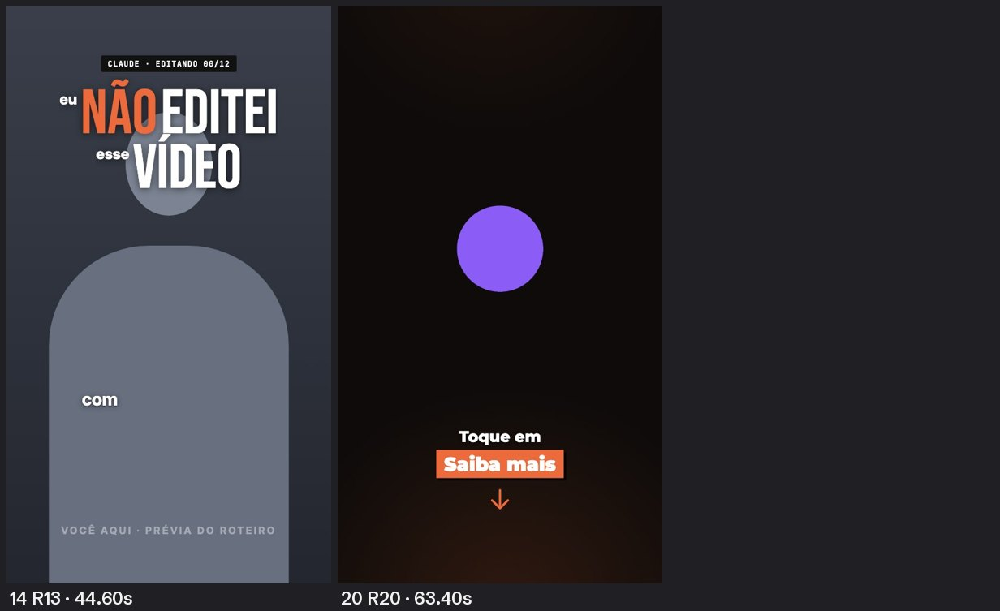

# video-pessoa — da ideia ao Reels editado, com IA

> Skill do Claude Code que transforma uma **ideia** em um Reels/TikTok de uma pessoa falando para a câmera, com edição de motion no estilo dos vídeos "editados por IA": entrevista sobre a ideia, roteiro com fala e direção de cada cena, prévia antes de gravar, cortes automáticos da gravação, recorte da pessoa, render e conferência.

**👤 Autor:** Ricardo Gasparelo · [Portfólio](https://githubiogithubio.vercel.app) · [LinkedIn](https://www.linkedin.com/in/ricardo-gasparelo-212381380/)

*Prévia gerada **antes** da gravação: a pessoa aparece em silhueta para validar layout, títulos e CTA.*

---

## O problema

Gravar é fácil; editar no estilo dos vídeos que performam (títulos atrás da cabeça, painéis animados, legenda palavra a palavra, CTA) leva horas, e quase sempre a pessoa descobre na edição que faltou gravar alguma coisa.

## O que eu construí

Um processo completo, com **paradas de aprovação** nos pontos em que errar sai caro:

| # | Etapa | O que acontece |
|---|---|---|
| 1 | **Entrevista** | até 3 rodadas de perguntas com opções: objetivo, público, duração, CTA, estrutura, materiais |
| 2 | **Plano** | roteiro com fala + direção de cena + layout de cada momento, a partir de **20 receitas** tiradas das referências |
| 3 | **Material externo** | logos, prints e fotos, mostrados antes de usar |
| 4 | **Prévia do roteiro** ⏸ | folhas de quadros com a pessoa em silhueta para aprovar antes de gravar |
| 5 | **Roteiro para gravar** | roteiro cena a cena + texto de teleprompter |
| 6 | **Importar e cortar** | transcreve, encaixa no roteiro, fica com a melhor tomada, tira erros e hesitações e encurta pausas |
| 7 | **Rosto + recorte** | rosto a cada 0,1 s para enquadrar e pôr títulos **atrás da cabeça**; recorte da pessoa só onde precisa |
| 8–9 | **Conferir e prévia** ⏸ | folhas de quadros e prévia com áudio para aprovação |
| 10 | **Final + conferência** | 1080×1920, −14 LUFS, .srt e checagem automática de formato, volume, sincronia e legenda |

## Como eu desenhei

- **Estudo de referência:** 29 vídeos "editados por IA" analisados quadro a quadro; a skill copia a **linguagem de edição**, nunca o tema.
- **Tudo ancorado na fala:** cada elemento visual aparece na palavra certa (`"em": "trecho da fala"`), nunca em segundos digitados à mão.
- **Uma ideia por cena:** algo novo a cada 1,5–3 s e um recurso forte por cena, para não virar vitrine de efeitos.
- **Limites honestos:** a skill diz o que não faz (trocar roupa por IA, rastrear mãos) e propõe outro caminho.

## Tecnologias

`Claude Code (skills)` `Python` `FFmpeg` `Whisper` `detecção de rosto` `segmentação de pessoa` `Remotion (React)` `TypeScript`

Layouts: tela cheia, dividida, card, recorte com fundo temático, lado a lado (16:9) · Painéis, títulos cromados/condensados, HUD de rastreio, contador, capturas inclinadas, hub de logos, CTA de comentário + direct.

## Skills irmãs

- [skill-video-ia](https://github.com/ricardogasparelo/skill-video-ia): vídeos 100% animados a partir da narração
- [skill-editor-video](https://github.com/ricardogasparelo/skill-editor-video): edição de entrevistas do Papo de Fundador

---

### Sobre o código

Este repositório é a **vitrine** da skill. O código-fonte completo é privado. Para uma demonstração ou acesso ao código, fale comigo no [LinkedIn](https://www.linkedin.com/in/ricardo-gasparelo-212381380/).

© 2026 Ricardo Friedrich Gasparelo. Todos os direitos reservados. Veja [LICENSE](LICENSE).
